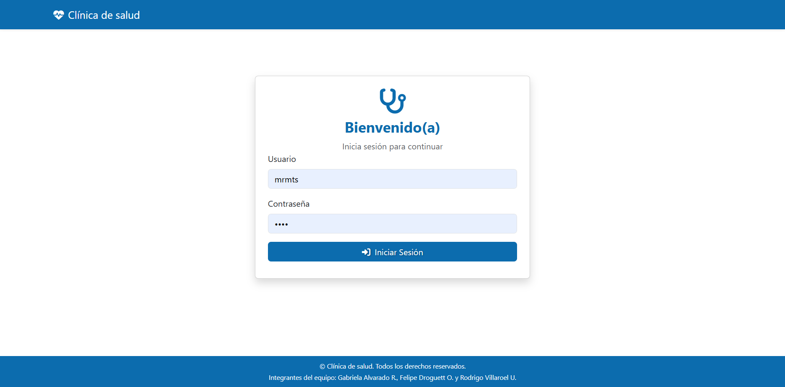
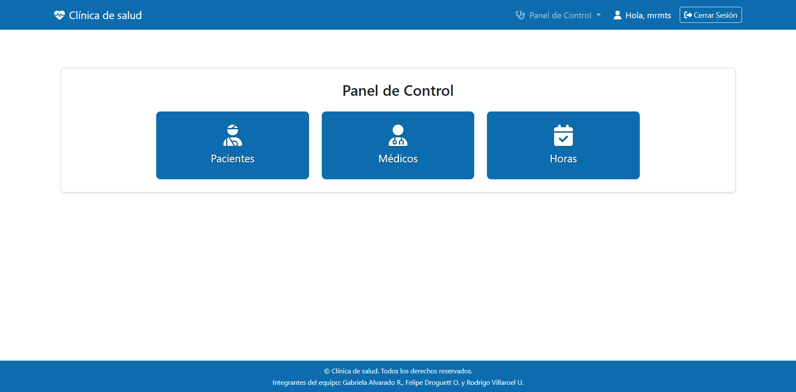
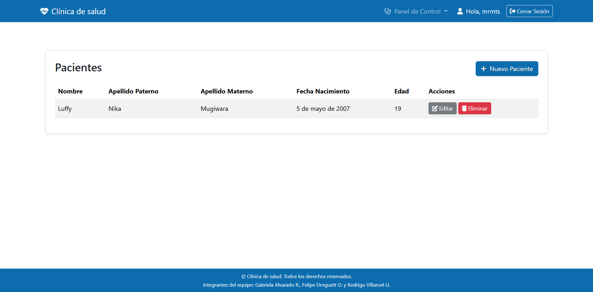
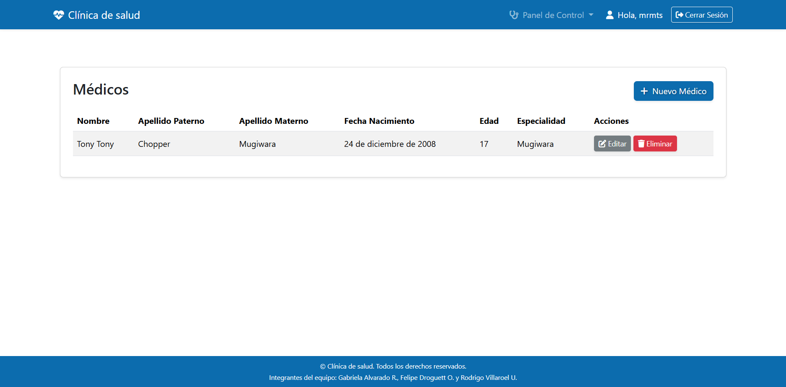
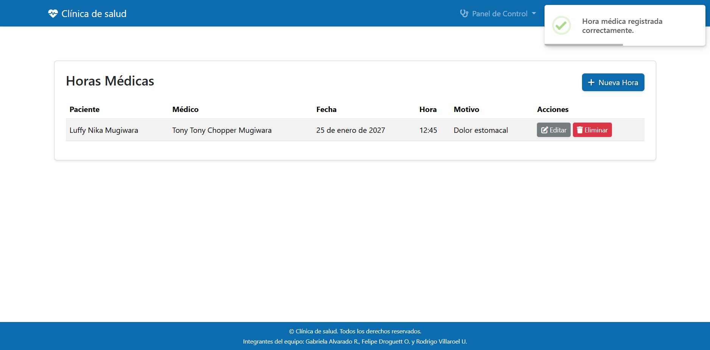
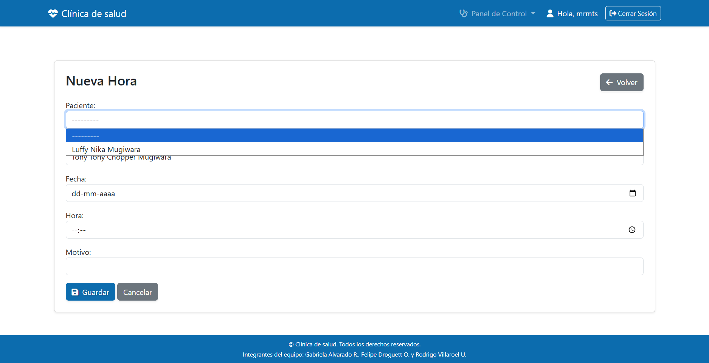
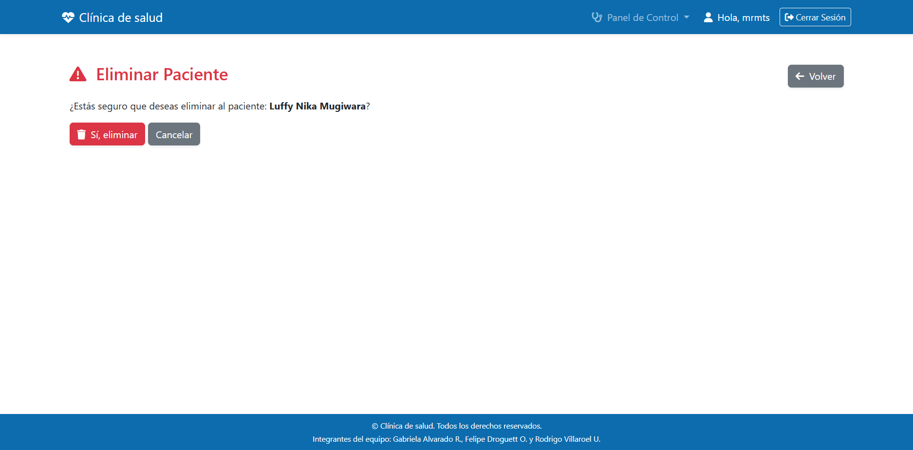

[Leer en español](README_es.md)

# Clinic Management System

Web application built with **Django** and **PostgreSQL** to manage a clinic's patients, doctors, and medical appointments in a single system, replacing manual scheduling and paper records.

> Team project developed with Felipe Droguett and Rodrigo Villaroel as part of the Kibernum / SENCE Full Stack Python program.

## Features

- **Authentication:** login and logout, with a control panel as the landing page after signing in
- **Patient management:** create, view, edit, and delete patients (CRUD)
- **Doctor management:** create, view, edit, and delete doctors (CRUD), including specialty
- **Appointment scheduling:** create appointments by selecting previously registered patients and doctors, with date, time, and reason
- **Filtering:** queries and filters using the Django ORM
- **Safe deletion:** dedicated confirmation page before any record is deleted
- **User feedback:** toast notifications (SweetAlert2) confirm actions such as creating an appointment
- **Automated tests:** test suite runnable with `python manage.py test`
- **Secure configuration:** secrets and database credentials loaded from environment variables (`python-decouple`) and passwords hashed with bcrypt
- **Localization:** Spanish interface, `America/Santiago` time zone

## Tech Stack

| Layer | Technology |
|---|---|
| Backend | Python, Django 6 |
| Database | PostgreSQL (`psycopg`) |
| Frontend | Django templates, HTML, CSS, Bootstrap 5, Font Awesome, SweetAlert2 |
| Configuration | python-decouple (`.env`) |
| Security | bcrypt password hashing |

## Screenshots

| Login | Control panel |
|---|---|
|  |  |

| Patients list | Doctors list |
|---|---|
|  |  |

| Appointments list | Appointment form |
|---|---|
|  |  |

*Appointment form: patients and doctors previously registered are selected from dropdowns to create an appointment.*

| Delete confirmation page |
|---|
|  |

## Project Structure

```
Clinica-de-salud-M7/
├── clinica_M7/        # Project settings and URL configuration
├── gestion/           # Main app: models, views, forms, tests
├── templates/         # HTML templates
├── static/            # CSS, JS, and images
├── docs/              # README screenshots
├── manage.py
├── requirements.txt
└── .env.example       # Environment variables template
```

## Requirements

- Python 3.12 or higher
- PostgreSQL

## Getting Started

1. **Clone the repository**
   ```bash
   git clone https://github.com/Marmopache/Clinica-de-salud-M7.git
   cd Clinica-de-salud-M7
   ```

2. **Create and activate a virtual environment**
   ```bash
   python -m venv venv
   venv\Scripts\activate        # Windows
   source venv/bin/activate     # macOS / Linux
   ```

3. **Install dependencies**
   ```bash
   pip install -r requirements.txt
   ```

4. **Create the PostgreSQL database**, then copy `.env.example` to `.env` and fill in your values:
   ```
   SECRET_KEY=your-secret-key
   DEBUG=True
   ALLOWED_HOSTS=localhost,127.0.0.1
   DB_NAME=clinica
   DB_USER=postgres
   DB_PASSWORD=your_password
   DB_HOST=localhost
   DB_PORT=5432
   ```
   To generate a secret key:
   ```bash
   python -c "from django.core.management.utils import get_random_secret_key; print(get_random_secret_key())"
   ```

5. **Run migrations**
   ```bash
   python manage.py migrate
   ```

6. **Create an admin user**
   ```bash
   python manage.py createsuperuser
   ```

7. **Start the development server**
   ```bash
   python manage.py runserver
   ```
   Then open http://127.0.0.1:8000/

## Running Tests

```bash
python manage.py test
```

## What I Practiced

- Designing relational models and relationships in PostgreSQL
- Building CRUD views and forms with Django
- Querying and filtering data with the Django ORM
- Writing automated tests
- Managing secrets with environment variables and hashing passwords securely
- Collaborating in a team with Git and GitHub

## Authors

Team project by **Gabriela Alvarado Rosales**, Felipe Droguett O., and Rodrigo Villaroel U.
Developed in the Kibernum / SENCE Full Stack Python program.

GitHub: [@Marmopache](https://github.com/Marmopache)
